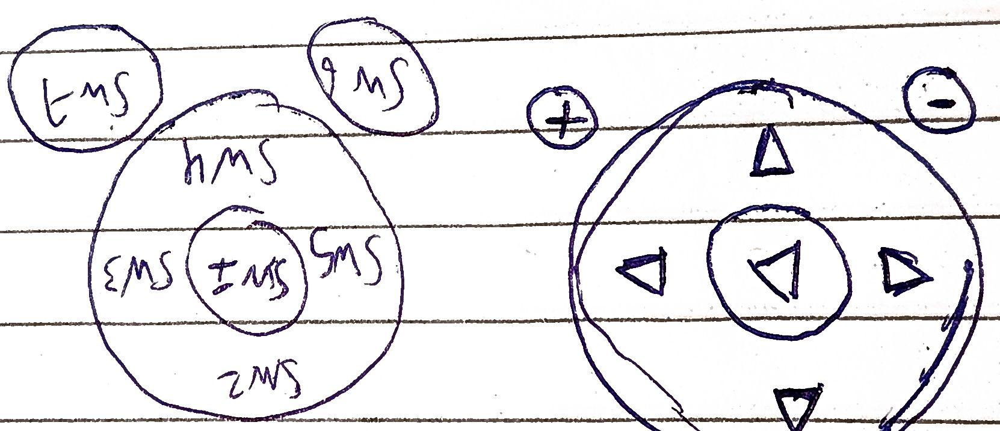

# MP3 - Urani House

## Button layout

## Special components on PCB

| Name                  | MPN           | Source | Source No. | Description                                                  |
| --------------------- | ------------- | ------ | ---------- | ------------------------------------------------------------ |
| LCD                   | HS24CG003-ARX | LCSC   | C5329583   | 240*320 dots (RGB) SPI INTERFACE                             |
| FPC connector for LCD | LW10251-16    | LCSC   | C375934    | CONN FFC FPC 16POS 1mm TOP CNT SMD R/A                       |
| TF slot               | TF PUSH       | LCSC   | C393941    | CONN MICRO SD CARD (TF CARD) PUSH-PUSH SMD                   |
| Debug Slider          | YSSP2AG00     | LCSC   | C5188558   | 300mA Surface Mount,Vertical DPDT 4V SMD Slide Switches RoHS |
| Audio Jack            | PJ-342 141    | LCSC   | C7507452   | CONN JACK STEREO 3.5mm SMD                                   |

## Communication protocols peripherals

### SPI - MISO/MOSI

| Peripheral | Max speed | Use          |
| ---------- | --------- | ------------ |
| SPI 1      | 50 Mbit/s | LCD          |
| SPI 2      | 25 Mbit/s | None         |
| SPI 3      | 25 Mbit/s | None         |
| SPI 4      | 50 Mbit/s | None         |
| SPI 5      | 50 Mbit/s | LCD touch IC |

### I2C - SDA/SCL

Their frequency can be increased up to 1 MHz. For more details on
the complete solution, refer to the nearest STMicroelectronics sales office.

| Peripheral | Max speed | Use           |
| ---------- | --------- | ------------- |
| I2C x      | 1 MHz     | None          |
| I2C x      | 400 KHz   | HMI expansion |
| I2C x      | 400 KHz   | None          |
| I2C x      | 400 KHz   | None          |
